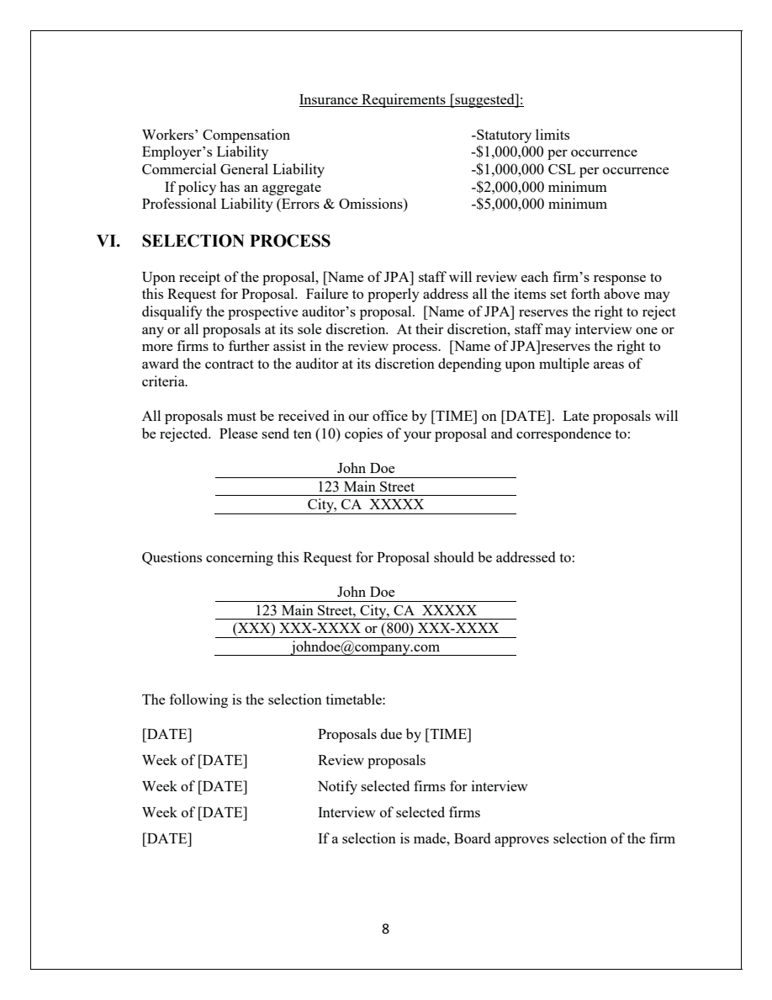

# Local PageIndex example results

October 27, 2026. The single-document example completed successfully; its answer and cited page were checked against the source.

## Question and answer

**Document:** CAJPA Sample Investment Management Request for Proposal, 9 pages.

**Question INV-01:** How many proposal copies does the RFP require? The run used the original English question from the dataset without rewriting it.

**PageIndex answer:** "Ten (10) copies of the proposal must be sent." It cited PDF page 8.

**Source evidence:** "Please send ten (10) copies of your proposal and correspondence to:"

The scoring reference was read only after generation and requires ten copies. Extracted-text matching and a full-page visual check confirmed the answer.
The reference answer was not included in indexing or answering.

## Observed execution

1. Read the original PDF locally and build a Flash section index with 11 nodes.
2. Call `get_document_structure` to inspect the structure.
3. Locate `VI. SELECTION PROCESS`, spanning pages 8-9.
4. Call `get_page_content` to read pages 8-9.
5. Answer ten copies and cite page 8.

This first example included a custom instruction to inspect the structure before reading original pages, to demonstrate tree-based retrieval on a short PDF.

## Timing and usage

| Stage | Time | Model calls | Input tokens | Output tokens |
|---|---:|---:|---:|---:|
| Indexing | 25.974 seconds | 8 | 5,158 | 1,156 |
| Retrieval and answering | 17.274 seconds | 3 | 9,742 | 111 |
| Total | 43.411 seconds, including inter-stage overhead | 11 | 14,900 | 1,267 |

Timing excludes installation and initial dependency imports. Indexing is a one-time cost. Chat usage includes multi-turn tool context,
with 5,399 cached input tokens. Billing also depends on cache writes; token totals are not an invoice.

## Configuration and verification

- Local Windows Python 3.11.15 in a separate `.venv`.
- PageIndex 0.2.10, source commit `e38b40ebaeea26d2c7206b80ce7bc9bf2935cdec`.
- Both indexing and answering explicitly used `gpt-6-sol`; all 11 responses returned that model.
- Flash indexing, summary concurrency 2, indexing reasoning none; chat used the Responses API with low reasoning effort.
- Only the existing Sirchmunk container's connection settings were read. PageIndex did not run in the container.
- The selected public document text and query were sent to `api.openai.com`; no key was saved in the project.
- The PDF matched the publicly downloadable CAJPA original byte for byte.
- SHA-256 hashes were unchanged for 82 core inputs: 78 PDFs, three question files, and the document manifest.

The original `copy_manifest.json` also references the now-absent `questions/approved_corrections.jsonl`.
This auxiliary file was not used, restored, or modified.

## Scope

This was a functional test with one specified PDF, demonstrating local indexing, section lookup, page reading, and an answer with a page citation.
It did not test autonomous source selection from all 78 documents or run the full set of 110 questions.

## Detailed records

- [Raw result](result.json)
- [Section index](tree.json)
- [Tool calls and evidence](tool_trace.json)
- [Verification record](verification.json)

