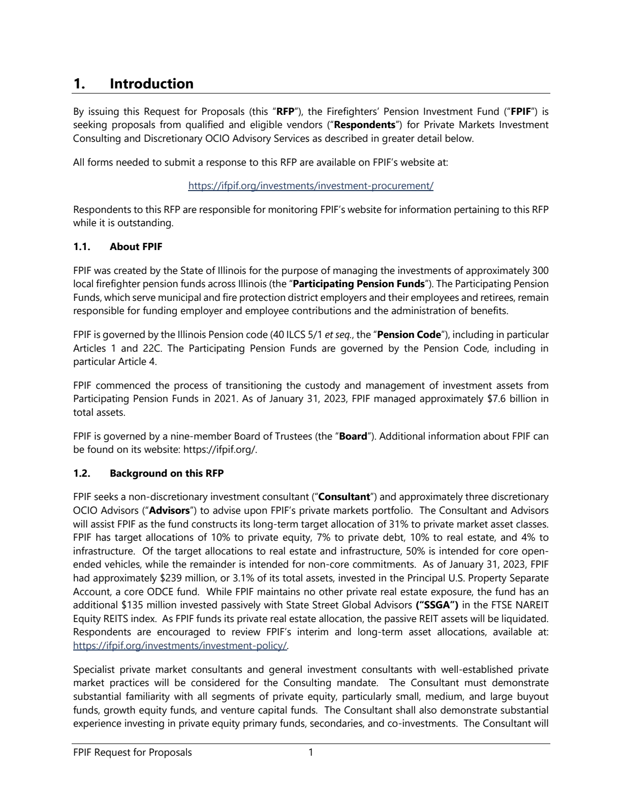

# Second local PageIndex example

October 27, 2026 | Illinois FPIF, 33 pages | INV-04 | Answer and source citation verified.

This run followed the pinned official Quickstart's model roles: `gpt-6-luna` for indexing and `gpt-6-sol` for retrieval and answering,
both explicitly set to `medium`. It used the official default Flash index and agent prompts without the first example's custom structure-first instruction.

## Question and result

The question asks for the Illinois Firefighters' Pension Investment Fund's long-term private-market allocation and asset-class split in its February 2023 Private Markets RFP.
The request used the original English INV-04 text in `queries.json`.

**PageIndex answer:** Total private-market target **31%**, comprising **10% private equity**, **7% private debt**, **10% real estate**, and **4% infrastructure**.

The answer cited **PDF page 3**, printed page **1**, Section **1.2 Background on this RFP**.
After generation, the reference standard, extracted PDF text, and full-page image were checked; all five percentages matched.
Reference answers and scoring criteria were not included in indexing or answering.

## Models and observed requests

| Stage | Model | Reasoning effort | Successful calls | Time |
|---|---|---|---:|---:|
| Indexing, section summaries, and document description | gpt-6-luna | medium | 17 | 52.922 seconds |
| Retrieval, page reading, and answering | gpt-6-sol | medium | 5 | 14.062 seconds |
| Total | N/A | N/A | 22 | 67.032 seconds |

The 22 HTTP requests corresponded to 22 unique responses. All outgoing model and reasoning settings matched the configuration,
and all returned model names matched expectations. Indexing used Chat Completions with `reasoning_effort: medium`;
chat used the Responses API with `reasoning.effort: medium`. These checks inspected serialized request bodies, not just Python configuration values.

Timing includes minor inter-stage overhead, excludes dependency imports, and excludes the interrupted attempt described below.

## Retrieval path

The local section tree contained **18 nodes**, including **10 top-level nodes**. The model independently:

1. Called `browse_documents` to inspect the available library.
2. Called `get_document` for the RFP's metadata.
3. Called `get_document_structure` and located `1. Introduction`, PDF pages 3-5.
4. Called `get_page_content` to read PDF pages 3-4.
5. Returned the allocation percentages with a citation to page 3.

## Token usage

| Stage | Input tokens | Output tokens | Reasoning tokens within output | Total tokens |
|---|---:|---:|---:|---:|
| Indexing | 22,724 | 4,956 | 1,528 | 27,680 |
| Answering | 20,925 | 278 | 74 | 21,203 |
| Total | 43,649 | 5,234 | 1,602 | 48,883 |

Reasoning tokens are included in output totals. Input totals include multi-turn context and cached tokens.
Cache reads were 1,486 tokens for indexing and 12,401 for answering; detailed cache-write counts are in the raw results.
Token totals are not a dollar invoice.

## Environment and reproduction

- Local Windows Python 3.11.15; PageIndex 0.2.10.
- Official source commit `e38b40ebaeea26d2c7206b80ce7bc9bf2935cdec`.
- Flash with default full optimization, summary concurrency 2, at most 8 chat turns, and a 90-second request timeout.
- Credentials came from the authorized Sirchmunk configuration by reading the old container; PageIndex executed locally.
- The PDF matched the [public FPIF original](https://ifpif.org/wp-content/uploads/2023/02/Private-Markets-RFP-2023.02.13.pdf) byte for byte; requests went to `api.openai.com`.
- Hashes were unchanged for all 82 core input files.

See [RUN_EXAMPLE.md](../../../RUN_EXAMPLE.md) for current execution instructions. The current runner has since adopted official default limits;
the settings above describe this historical run. Its reusable local index was stored under `.pageindex/example-20261027-161105/`.

**Interrupted attempt:** In `20261027-160959`, the new recorder incorrectly treated LiteLLM's `openai/gpt-6-luna` prefix as a model mismatch,
triggering retries. The attempt was stopped, the recorder corrected, and the example rerun from the beginning.
This was a recording-script issue rather than a model-service or PageIndex failure. Its logs are retained;
completed responses incurred API usage excluded from this successful run's timing and token tables.
See the [interrupted attempt](../20261027-160959/result.json).

This was a functional example with one specified document, not autonomous retrieval across 78 PDFs or the complete 110-question evaluation.
Its document differs in length from the first example, so their timings do not directly compare model performance.

## Detailed records

- [Answer, configuration, and usage](result.json)
- [Section tree](tree.json)
- [Tool calls and original evidence](tool_trace.json)
- [Outgoing request settings](wire_requests.jsonl)
- [Observed response models and per-call usage](model_calls.jsonl)
- [Verification results](verification.json)

